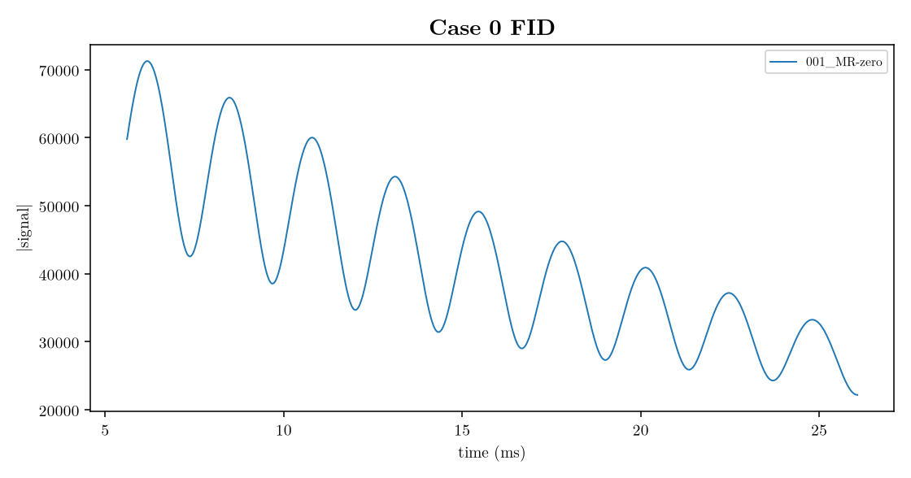
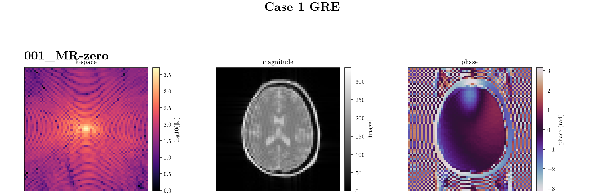
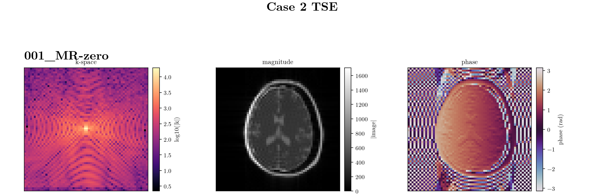
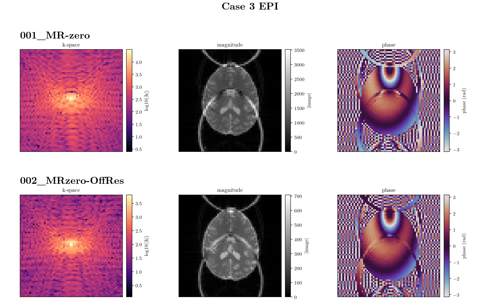
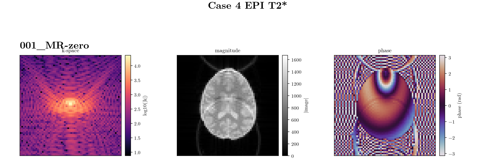

# Bloch Simulation Comparison Challenge

Every participant simulates 
- the **same Pulseq sequences**
- on the **same [BIfTI](https://github.com/mrx-org/bifti-phantoms) phantom**
- using the **same scanner constants** ([sequences/README.md](sequences/README.md)),
and submits
- the raw ADC signal.

How you set the simulator up — spin count,
voxel model, time step, anything else — is yours; the challenge wants each
tool's best result. The organisers reconstruct all submissions identically, so
that what is compared is Bloch physics rather than reconstruction modalities.
This is no challenge, there is no winner, this is only a comparison study, to see if Bloch simulations in the community agree.

## What you are given

| Path | Purpose |
| --- | --- |
| [sequences/](sequences/) | The four Pulseq 1.5.0 `.seq` files, and the scanner constants. |
| [phantoms/brainweb/](phantoms/brainweb/) | The 4 mm BrainWeb slab (`T2' = inf` and `T2'` as published). |

These two folders stay as published, including the scanner constants beside the sequences: B0, gamma, Larmor, FOV, matrix, slice thickness, and the hardware limits. Discretization, the intra-voxel model, the time step, the hardware, and the spin count are the team's choice.

## Cases

Five comparisons. Cases 0–3 share one phantom. Case 4 repeats the EPI sequence on the phantom that carries the published `T2'`. Scanner constants and sequence details are in [sequences/README.md](sequences/README.md). The phantom grid is in [phantoms/brainweb/README.md](phantoms/brainweb/README.md).

**Case 0, FID.** [sequences/case0_fid.seq](sequences/case0_fid.seq) on [phantoms/brainweb/challenge-brain-4mm.json](phantoms/brainweb/challenge-brain-4mm.json). No readout gradient, 1024 samples. Check for sign, conjugation, and scaling.

**Case 1, RF-spoiled GRE.** [sequences/case1_gre.seq](sequences/case1_gre.seq) on the same phantom, where `T2'` is infinite. 64x64 samples. Steady state, spoiling, and gradient handling.

**Case 2, TSE.** [sequences/case2_tse.seq](sequences/case2_tse.seq), four shots of 16 echoes, on the same phantom. 64x64 samples. Refocusing, stimulated echoes, and coherence pathways.

**Case 3, EPI.** [sequences/case3_epi.seq](sequences/case3_epi.seq), one 43.5 ms shot, on the same phantom. 64x64 samples. Gradient timing and off-resonance along the train.

**Case 4, EPI with T2'.** The same [sequences/case3_epi.seq](sequences/case3_epi.seq) on [phantoms/brainweb/challenge-brain-4mm-t2star.json](phantoms/brainweb/challenge-brain-4mm-t2star.json), where `T2'` is the published value. 4096 samples. The only change from case 3 is the T2* model.

## How to submit

- Fork and clone the repo.
- Load seq and BIfTIs to your simulator. (The bifti python package has has some predefined loaders [BIfTI](https://github.com/mrx-org/bifti-phantoms))
- Run your simulation, save ADC data as .h5 files.
- Copy [submission.json](submission.json) where details of your submission are stored in a structured manner, including a version, a commit, or the date of the run.  
- Make a PR or issue in this repo with ADC data and submission.json

A detailed submission description is in [submissions/README.md](submissions/README.md).

## Results

  

  

  

  

  

